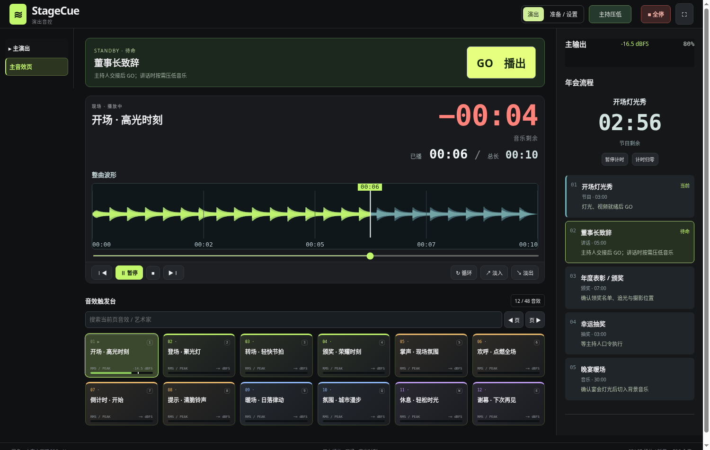

# 大型年会演出工作台（Mac 3.1）

## 主界面

首次打开默认进入演出模式。主界面保留待命 / GO、音乐波形、大号音乐时间、音效垫、年会流程和节目计时。体育比分、阵容、素材管理、编辑器、主题和路由等在“准备 / 设置”中继续可用。

顶部固定“主持压低 / 恢复音乐”和“全停”，滚动长流程时仍可操作。演出模式自动锁定编辑与音量设置；需要修改时切到准备模式。音量校准建议在准备阶段完成。

## 年会流程与 GO

1. 切到“准备 / 设置”，点击“年会流程 / 台令”或右侧“编辑流程”。
2. 添加音乐、讲话、颁奖、节目、抽奖或等待台令环节，填写计划分钟数、台令备注和可选音频。
3. 音频可选择直接切换、交叉淡变或叠加；无音频环节只启动计时，不停止或自动压低现场背景音乐。
4. 可以编辑、删除或上下调整环节。“复制旧演出流程表”可将原流程转换为年会环节，原音乐和旧流程表会保留。首次升级时默认按旧流程生成。
5. 进入演出模式，点选环节或音效待命，再按 GO / Enter 执行。只有选定不产生声音；GO 后下一环节仅待命，不自动执行。

默认音效垫和快捷键也先待命再 GO。需要直接触发音效时，可在准备模式取消“演出时点选音效先待命”。左右键 / 上一条、下一条按钮在演出模式只调整待命环节。

GO 执行期间及成功后的短暂间隔会阻止重复执行。临时播放音效不会重置正在进行的节目计时。Stream Deck 的触发与 GO 也遵循当前模式；实体设备仍需实测。

## 两种时间

音乐剩余、已播 / 总长和整曲波形继续独立显示。右侧节目计时按计划时长倒计时，超时后显示红色 `+` 时间；计划为 0 时显示正计时。

暂停节目计时不会暂停音乐。计时归零需要确认。无音乐的讲话、互动也可单独计时。

全停停止现场和耳机声音、解除定时任务武装、暂停节目计时，保留流程。已手动启用的定时播放任务属于独立计划，演出模式中仍按计划执行，页头显示武装状态。

## 备份与升级

演出备份包含年会流程、备注、计划时长和保存时的计时进度。重新打开或恢复后不会自动播音或继续计时，临时音效待命也不会恢复。新年会流程请使用 3.1 或更新版本恢复；旧版演出音乐备份仍可导入。

[Mac 安装与替换旧版](macos.md)。署名：中东中亚IT SSC   Alan。

## 大型年会还值得配置什么

| 项目 | 现在的状态 / 建议 |
| --- | --- |
| 素材预检、整场音频备份、耳机预听、响度校准 | 已有功能，建议准备阶段使用，并在备用电脑导入整场备份验证 |
| Excel 导演台本导入、打印版流程 | 后续推荐，当前未实现；适合导演、音控共用同一份流程 |
| 导演 / 主持提示屏 | 后续推荐，当前未实现；仅展示当前节目、下一节目和倒计时 |
| 主备双机自动切换 | 后续推荐，当前未实现；还需要声卡、切换设备及整套故障演练 |
| 视频、LED / 灯光时码联动 | 后续推荐，当前未实现；需要明确现场中控与设备协议后再集成 |
