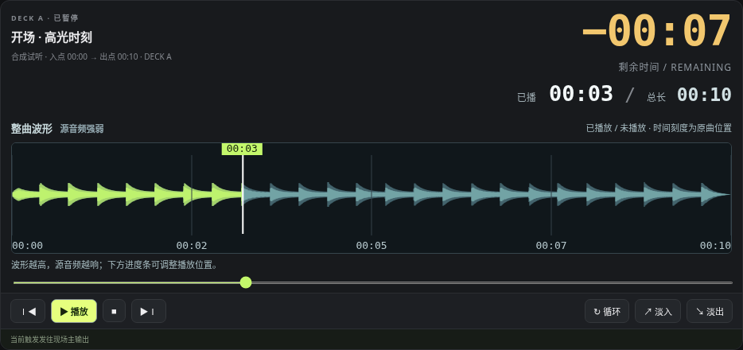

# 播放中的整曲波形与大号时间（Mac 3.0.2）

- 播放时显示整首源音频的强弱分布，波形越高，源音频幅度越大。波形保留在暂停画面中。
- 绿色为已播放部分，蓝灰色为未播放部分，白色竖线及顶部时间表示当前原曲位置。
- 时间刻度覆盖整首音乐；设置了入点/出点时显示 IN / OUT，范围以外的音频变暗。下方原有进度条仍可调整播放位置。
- 鼠标移到波形上，可查看该处的原曲时间及源采样峰值。
- 剩余时间放大至桌面约 54 px，窄窗口约 44 px；已播时间与总时长也单独放大、加粗、提高对比度。

波形表示源文件的采样强弱；现有实时电平表继续显示实际播放音轨的音量/效果后电平。波形读取和计算异步进行，不暂停或切换正在播放的音乐。切歌、停止、结束、裁切及变速对应的播放位置已经过检查。

波形暂不能解码时显示明确状态，播放与全停继续可用。为控制内存，预估解码体积超过 512 MiB 的长文件跳过波形生成；它仍可按原有播放能力播放。波形缓存只保存在本次运行内，不改变演出备份格式。

Mac 安装与升级见 [安装说明](macos.md)。
